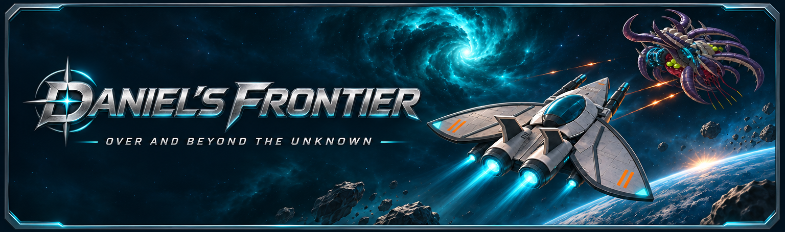

# Daniel's Frontier

**Current public release: v0.9.2.1** : Windows desktop

[Download the complete game](https://github.com/arusev-fce/DanielsFrontier-Releases/releases/latest/download/DanielsFrontier-Windows.zip) : [Latest patch notes](https://github.com/arusev-fce/DanielsFrontier-Releases/releases/latest)

Pilot a ship through a persistent shared universe. Fight hostile fleets, travel through portals, mine resources and build equipment that changes how your ship plays.

## 0.9.2.1: Quests and multiplayer hotfix

- Reworked Daily and Weekly objectives and workload-based Credits, XP, Aurum, Honor, material and equipment rewards. Four offers per track remain; accepted progress is retained.
- Main quests accept automatically, award completion rewards and activate the next assignment after three seconds. Selected Daily and Weekly quests also auto-claim. Completion notices and reward summaries appear in the event log.
- Compact sign-in quest reminder instead of opening the full quest window; consistent quest numbering in details/history.
- Shared HUD startup placement restores saved positions after frame sizing settles without requiring a first drag or rearranging overlapping panels.
- Tutorial dragging uses a broad header area and move cursor; pin/minimize buttons stay independent.
- Select other player ships to prefill Friends and Group without opening panels. Player attack targeting is blocked.
- Reduced server snapshot comparison allocations, redundant client delta processing and irrelevant combat-event traffic. Weapon-effect preparation runs before first combat. Old-life movement snapshots cannot reset a respawned ship.
- Escort display shows exact combined current/max convoy HP. Convoy attackers approach within damage range; close player interception still diverts them without blanket proximity diversion.
- Expedition kill-reward budgets are bounded per attempt rather than exhausted across retries. Existing reward receipts remain intact and completion rewards stay one-time.
- Normal expedition Rift Broodmother hull, shields and damage reduced by 35%; other difficulties and main-map enemies retain their stats.
- Boss phase labels use readable screen-space shared text sizing instead of tiny 3D text.
- Repaired corrupted text and standardized UI separators to colons. Added a source encoding checker.
- Matching private admin console uses the current catalog, shared text and release identity.

- Independent recovery-option cooldowns start only on use and expire while alive.

Existing saves, equipment and UI layouts are preserved. Client, server and admin console are updated together.

Known issue: the reported large combat hitch was not reproduced in bounded profiling; these improvements do not establish that every combat stall is eliminated.

Existing pilots, ships, equipment and earned progress are preserved. Matching client, server and private admin-console packages accompany this release.

## The game

| Combat | Exploration | Build your ship |
| --- | --- | --- |
Fight with lasers, rockets and drones. Watch hull and shield damage as encounters unfold. | Cross sector portals, discover stations and gather ores and supplies. | Equip weapons, generators, utilities and drones. Craft and improve gear using materials you earn. |

Choose a faction, grow your pilot and use the in-game encyclopedia and tutorial to learn the systems. Group expeditions offer shared objectives alongside ordinary sector play.

## Get started

1. Download the [latest Windows ZIP](https://github.com/arusev-fce/DanielsFrontier-Releases/releases/latest/download/DanielsFrontier-Windows.zip).
2. Extract the entire ZIP to a writable folder and run `DanielsFrontier.exe`.
3. Sign in with your pilot account. Use **Check for updates** in game for later releases.

Keep your pilot/save files when updating. Game downloads are public; registration is private and requires an invitation.

The banners above are original illustrations of the game's themes, not gameplay screenshots. Source code, server and owner tools remain private. Daniel's Frontier is proprietary; bundled third-party notices apply. No source-code or asset-reuse licence is granted.

## 0.8.9.11 - Smoother online play and reliable expeditions

- Reduced snapshot traffic and improved server save scheduling.
- More consistent online events, reconnects and combat updates.
- Fixed escort completion, extraction and expedition Aurum/Honor rewards.
- Clearer Statistics, encyclopedia guidance and material icons for batch disassembly.

Existing pilots, equipment and wallets are preserved.
