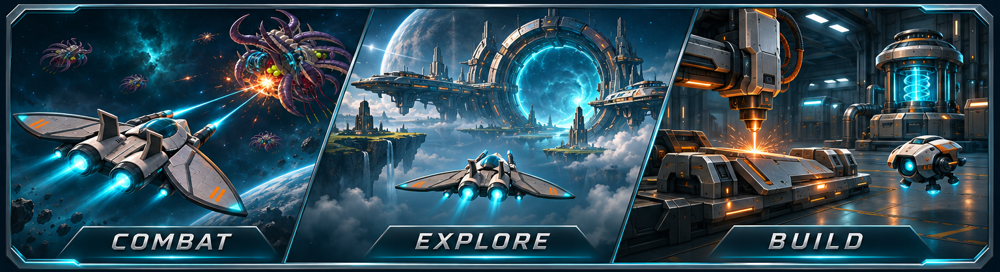

# Daniel's Frontier

**Current public release: v0.9.0** : Windows desktop

[Download the complete game](https://github.com/arusev-fce/DanielsFrontier-Releases/releases/latest/download/DanielsFrontier-Windows.zip) · [Latest patch notes](https://github.com/arusev-fce/DanielsFrontier-Releases/releases/latest)

Pilot a ship through a persistent shared universe. Fight hostile fleets, travel through portals, mine resources and build equipment that changes how your ship plays.

## 0.9.0 : Quests and frontier progression

### A new chapter
- 700 Main story assignments, with 140 Daily and 134 Weekly quest variations.
- Combat, exploration, gathering, crafting, spending, donation and expedition objectives.
- One active Main, Daily and Weekly quest at a time, with a compact tracker and completion history.
- Choose from 3 Daily and 5 Weekly assignments each period, with one active per track. Preview before accepting.
- J opens Quests; the shortcut is listed in Controls.
- Compact styled tracker, short offer previews and shared UI typography.
- Daily resets at 00:00 UTC; Weekly resets Monday at 00:00 UTC. Completed unclaimed rewards remain claimable.
- Daily rerolls every six hours; Weekly rerolls every day. Rerolling starts fresh progress.
- Full character portraits and clear five-ship difficulty ratings, plus dedicated XP and Honor icons.

### Progression and rewards
- Reviewed quest difficulty and rewards across the campaign; passive collection no longer masquerades as elite combat.
- Regional component requirements for portals, with ore and stabilizer costs preserved.
- Revised combined portal and chest rewards; existing earned pity progress is retained.
- Corrected authoritative boss pity, shared Honor rounding and portal Credit-fee quotes.
- Mining income advances eligible gathering objectives and material statistics.
- Safer batch dismantling and defabrication arithmetic.

### Smoother online play
- Reduced repeated snapshot and actor-delta work.
- Reused transaction buffers and removed repeated loadout validation work.
- Improved save scheduling and memory retention, with durable saves and valid backups preserved.
- Inactive combat histories expire even when nobody is polling that map.

### Interface improvements
- Clear settings-save feedback, server-status colours and layout snapping.
- Updated updater progress presentation and selected background/star corrections.
- Removed unnecessary expedition gate labels.

Existing pilots, ships, equipment and earned progress are preserved. Matching client, server and private admin-console packages accompany this release.

## The game

| Combat | Exploration | Build your ship |
| --- | --- | --- |
Fight with lasers, rockets and drones. Watch hull and shield damage as encounters unfold. | Cross sector portals, discover stations and gather ores and supplies. | Equip weapons, generators, utilities and drones. Craft and improve gear using materials you earn. |

Choose a faction, grow your pilot and use the in-game encyclopedia and tutorial to learn the systems. Group expeditions offer shared objectives alongside ordinary sector play.

## Get started

1. Download the [latest Windows ZIP](https://github.com/arusev-fce/DanielsFrontier-Releases/releases/latest/download/DanielsFrontier-Windows.zip).
2. Extract the entire ZIP to a writable folder and run `DanielsFrontier.exe`.
3. Sign in with your pilot account. Use **Check for updates** in game for later releases.

Keep your pilot/save files when updating. Game downloads are public; registration is private and requires an invitation.

The banners above are original illustrations of the game's themes, not gameplay screenshots. Source code, server and owner tools remain private. Daniel's Frontier is proprietary; bundled third-party notices apply. No source-code or asset-reuse licence is granted.

## 0.8.9.11 - Smoother online play and reliable expeditions

- Reduced snapshot traffic and improved server save scheduling.
- More consistent online events, reconnects and combat updates.
- Fixed escort completion, extraction and expedition Aurum/Honor rewards.
- Clearer Statistics, encyclopedia guidance and material icons for batch disassembly.

Existing pilots, equipment and wallets are preserved.
