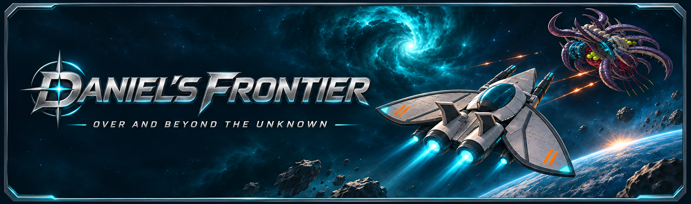
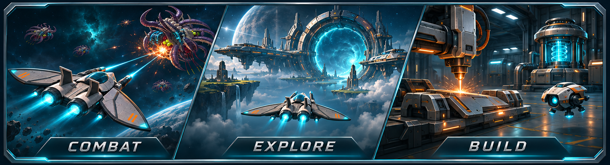

# Daniel's Frontier

**Current public release: v0.8.9.3** · Windows desktop

[Download the complete game](https://github.com/arusev-fce/DanielsFrontier-Releases/releases/latest/download/DanielsFrontier-Windows.zip) · [Latest patch notes](https://github.com/arusev-fce/DanielsFrontier-Releases/releases/latest)

Pilot a ship through a persistent shared universe. Fight hostile fleets, travel through portals, mine resources and build equipment that changes how your ship plays.

## The game

| Combat | Exploration | Build your ship |
| --- | --- | --- |
Fight with lasers, rockets and drones. Watch hull and shield damage as encounters unfold. | Cross sector portals, discover stations and gather ores and supplies. | Equip weapons, generators, utilities and drones. Craft and improve gear using materials you earn. |

Choose a faction, grow your pilot and use the in-game encyclopedia and tutorial to learn the systems. Group expeditions offer shared objectives alongside ordinary sector play.

## Get started

1. Download the [latest Windows ZIP](https://github.com/arusev-fce/DanielsFrontier-Releases/releases/latest/download/DanielsFrontier-Windows.zip).
2. Extract the entire ZIP to a writable folder and run `DanielsFrontier.exe`.
3. Sign in with your pilot account. Use **Check for updates** in game for later releases.

Keep your pilot/save files when updating. Game downloads are public; registration is private and requires an invitation.

## Latest release: 0.8.9.3

This hotfix updates all seven player-ship models while preserving their runtime scale, weapon and engine origins, faction skin selection and existing gameplay balance. [Read the 0.8.9.3 release notes](https://github.com/arusev-fce/DanielsFrontier-Releases/releases/tag/v0.8.9.3).

The banners above are original illustrations of the game's themes, not gameplay screenshots. Source code, server and owner tools remain private. Daniel's Frontier is proprietary; bundled third-party notices apply. No source-code or asset-reuse licence is granted.
